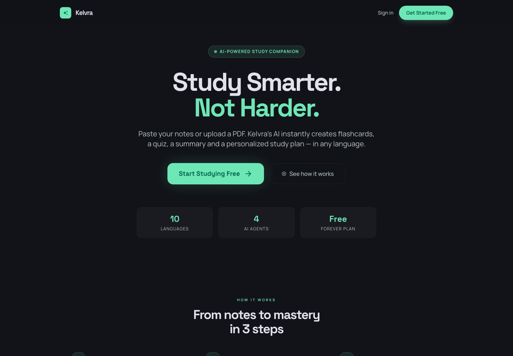

# Kelvra: AI study app

**What:** paste notes or upload a PDF or photo, and get flashcards, a quiz, a summary and a 5-day study plan, in 10 languages.
**For:** students preparing for exams who want study material made from their own notes.
**Run:** `npm install`, copy `.env.example` to `.env` and fill it in, then `npm run dev` and open http://localhost:5173.

Live: https://kelvra.vercel.app/



## Commands

```
npm run dev      # app + the /api/groq function, http://localhost:5173
npm test         # server function tests (node --test)
npm run lint
npm run build    # production build into dist/
```

## How it works

- React + Vite + Tailwind, installable as an app (PWA). Login and data: Supabase.
- AI: the browser calls `/api/groq` ([`api/groq.js`](api/groq.js), a Vercel function). It checks the user is signed in,
  adds the Groq key from the server-only `GROQ_API_KEY`, and picks the model: `openai/gpt-oss-120b` for text,
  `qwen/qwen3.8-27b` for photos and handwriting. The key is never sent to the browser.
- Deploy: Vercel. Set `VITE_SUPABASE_URL`, `VITE_SUPABASE_ANON_KEY` and `GROQ_API_KEY` in the project's environment variables.

## Not done yet

- The database tables (`agent_plans`, `exam_goals`, `quiz_scores`, `shared_kits`, `study_sessions`, `user_xp`) were made in the
  Supabase dashboard; their SQL is not in this repo yet, so a fresh Supabase project needs them created by hand.
- Photo and handwriting reading uses a Groq preview model, which Groq may retire at short notice.
- Tests cover the AI server function only, not the pages.
