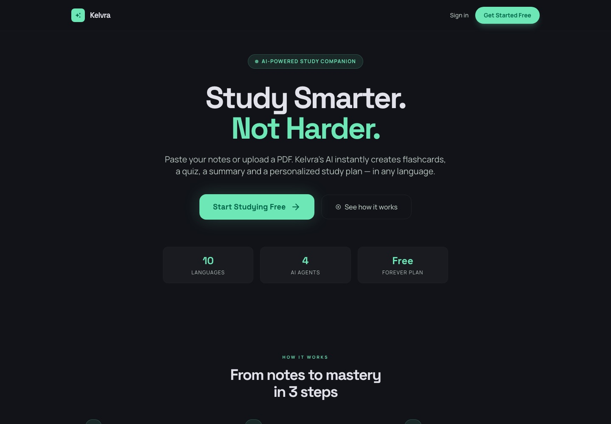

# Kelvra: AI study app with a mentor

**What:** paste notes or upload a PDF or photo, and get flashcards, a quiz, a summary and a 5-day study plan, in 10 languages.
An AI mentor then reads your real progress (quiz scores, weak topics, exam date) and helps with weekly goals, real-world uses of topics, careers, and getting unstuck.
**For:** students preparing for exams who want study material made from their own notes.
**Run:** `npm install`, copy `.env.example` to `.env` and fill it in, then `npm run dev` and open http://localhost:5173.

Live: https://kelvra.vercel.app/



## Commands

```
npm run dev         # app + the /api/groq function, http://localhost:5173
npm test            # server function tests (node --test)
npm run emulators   # local Firebase Auth + Firestore (needs Java)
npm run test:rules  # security-rule tests, run while the emulators are up
npm run lint
npm run build       # production build into dist/
```

## How it works

- React + Vite + Tailwind, installable as an app (PWA). Pages load on demand, so the landing page stays small.
- **Login and data: Firebase** (Auth + Cloud Firestore). Firestore keeps a copy in the browser, so the dashboard, progress,
  goals and mentor chat open offline, and changes sync when the connection returns. Data layout is at the top of
  [`src/utils/firebase.js`](src/utils/firebase.js); who can read and write what is in [`firestore.rules`](firestore.rules).
- **AI:** the browser calls `/api/groq` ([`api/groq.js`](api/groq.js), a Vercel function). It checks the Firebase ID token,
  adds the Groq key from the server-only `GROQ_API_KEY`, and picks the model: `openai/gpt-oss-120b` for text,
  `qwen/qwen3.8-27b` for photos and handwriting. The key is never sent to the browser.
- **Navigation:** 5 sections instead of 18 links: **Home** (today's plan), **Learn** (study kit, flashcards, AI tutor, explore),
  **Practice** (review, quiz, mistakes, answer coach), **Coach** (mentor, habits, focus, test debrief, stress reset) and **Me**
  (progress, exam forecast, family update, leaderboard, settings). Defined in [`src/utils/nav.js`](src/utils/nav.js); a test checks
  that every page is in the menu.
- **Mentor:** [`src/pages/MentorPage.jsx`](src/pages/MentorPage.jsx) and [`src/utils/mentor.js`](src/utils/mentor.js).
- **Learning features** (data in [`src/utils/learning.js`](src/utils/learning.js), all offline-capable):
  - **Mistake notebook** (`/mistakes`): every wrong quiz answer is saved by topic; retest until mastered; "ask my mentor" per mistake.
  - **Review deck** (`/review`): flashcards from every study kit join a spaced-repetition deck (simplified SM-2 in
    [`src/utils/srs.js`](src/utils/srs.js)); rate Again / Hard / Good / Easy, only due cards are shown.
  - **Today plan + check-in** (dashboard): 3-4 tasks built from due cards, open mistakes, weak topics and the exam date
    ([`src/utils/todayPlan.js`](src/utils/todayPlan.js), no AI needed), plus a mood / minutes / note check-in.
  - **Career & project explorer** (`/explore`): real-world uses, jobs, a hands-on project and interview questions for any topic.
  - The mentor reads all of it (mistakes, due cards, recent check-ins) before answering.
- **Behaviour features** (based on the research report in [`reports/`](reports/)):
  - **Answer-writing coach** (`/answer`): write or speak a full exam answer; feedback on 5 rubric points shown as bands, a marks
    *range*, one biggest fix, a required rewrite, and the model answer only after trying ([`src/utils/answerCoach.js`](src/utils/answerCoach.js)).
  - **Confidence check** (Quiz): Guess / Unsure / Sure before seeing the answer; "sure but wrong" goes to the top of the
    Mistake notebook; "how sure vs how right" card ([`src/utils/confidence.js`](src/utils/confidence.js)).
  - **Focus tracker** (`/focus`): notices leaving the tab, one-tap reason, 10-second reflection, private weekly focus summary
    ([`src/utils/focus.js`](src/utils/focus.js)).
  - **Habit coach** (`/habits`): patterns from real activity (days studied, late nights, cramming) and one if-then experiment a
    week, counted as "X of 7 days", never a streak ([`src/utils/habits.js`](src/utils/habits.js)).
- **Family and wellbeing** (student-controlled, nothing is sent by Kelvra itself):
  - **Family update** (`/family`): the student picks what to share, sees "Preview as parent", and sends a weekly summary on
    WhatsApp in English or Hindi; effort first, scores only if opted in, never rank, mood or chats ([`src/utils/family.js`](src/utils/family.js)).
  - **Test debrief** (`/debrief`): where the marks went, one fix (can become the week's habit), optional calm message for parents.
  - **Mistake "why" report** (Mistakes page): AI finds 2-3 recurring patterns across open mistakes, with a fix each.
  - **Stress reset** (`/reset`, quick mode `/reset?quick=1`): "stress can fuel you + abilities grow" cards, 1-minute breathing,
    note to a junior; optional worry dump that is never saved. Today's plan offers it when an exam is ≤ 3 days away and gets
    lighter after a poor night's sleep.
  - **Leaderboard is opt-in**: nobody is listed unless they choose to be (enforced in `firestore.rules`).
- **Curiosity features** (from [`reports/Kelvra unique curiosity features.md`](reports/)):
  - **Plot Twist mode:** new study kits open with 2-3 free guesses; a "Sure but wrong" answer gets a plot-twist reveal, a
    second look at the end of the quiz, and comes back the next day in Today's plan ([`src/utils/plotTwist.js`](src/utils/plotTwist.js)).
  - **Your-world mode** (Quiz): questions retold in an interest the student picked (cricket, music, coding...). Only the
    question text changes; every number must survive the rewrite or the original is kept ([`src/utils/yourWorld.js`](src/utils/yourWorld.js)).
    **"Why would I care?"**: once per topic the student writes why it matters to them.
  - **Parent Explainer notes** (`/explain`, public): one-minute explainers in English and Hindi (percentile, normalisation,
    counselling, two board exams, rumours, sleep...), read aloud by the phone, with official sources ([`src/data/explainers.js`](src/data/explainers.js)).
  - **Daily Grid** (`/grid`, no sign-up): one shared 5-question puzzle a day per exam, a spoiler-free share grid
    (`Kelvra NEET #5 4/5 🟩🟩🟨🟩⬛`) and how other players answered ([`src/utils/grid.js`](src/utils/grid.js), bank in
    [`src/data/gridBank.js`](src/data/gridBank.js)). Votes and counts are protected by `firestore.rules`.
  - **Exam forecast** shows a readiness *range* with its assumptions, and "days studied (last 7)" instead of a streak.
- **Safety:** messages that sound like self-harm are not sent to the AI or saved; the student sees Tele-MANAS 14416 instead
  ([`src/utils/safety.js`](src/utils/safety.js)). Onboarding asks only an age group; unknown age is treated as under 18.

## Demo preview without a Firebase project

Runs the real app against local Firebase emulators, reachable from another device (e.g. a phone) through the dev server:

```
npm run emulators   # terminal 1 (needs Java)
VITE_FIREBASE_API_KEY=demo-key VITE_FIREBASE_AUTH_DOMAIN=demo-kelvra.firebaseapp.com VITE_FIREBASE_PROJECT_ID=demo-kelvra \
VITE_FIREBASE_APP_ID=demo VITE_FIREBASE_EMULATOR=true VITE_FIREBASE_EMULATOR_PROXY=true npx vite --host 0.0.0.0
```

Emulator data is lost when the emulators stop. AI features need a reachable `GROQ_API_KEY`.

## Set up Firebase (once)

1. Go to https://console.firebase.google.com, **Add project** (Google Analytics not needed).
2. **Build > Authentication > Get started.** Turn on **Email/Password** and **Google**.
3. **Authentication > Settings > Authorized domains:** add `kelvra.vercel.app` (and any custom domain).
4. **Build > Firestore Database > Create database**, production mode, a region near your users (for India: `asia-south1`).
5. **Project settings > General > Your apps > Web (`</>`)**, register the app, and copy the config values into
   `.env` as the `VITE_FIREBASE_*` variables (see `.env.example`).
6. Deploy the security rules (without this, Firestore blocks every read and write):
   `npx firebase-tools login`, then `npx firebase-tools deploy --only firestore:rules --project <your-project-id>`.
7. **Vercel > Project > Settings > Environment Variables:** add the same `VITE_FIREBASE_*` values and `GROQ_API_KEY`,
   remove the old `VITE_SUPABASE_*` ones, then redeploy.

The free Spark plan is enough to start and, unlike Supabase's free tier, does not pause the project when it is quiet.

## Launch checklist (what you need to set on Vercel)

| Setting | Why |
|---|---|
| `VITE_FIREBASE_*`, `GROQ_API_KEY` | Login, data and AI |
| `UPSTASH_REDIS_REST_URL`, `UPSTASH_REDIS_REST_TOKEN` (Vercel > Storage > Upstash, free) | Real per-student AI limits. Without them the limit only counts per server instance. |
| `AI_DAILY_LIMIT` (default 120), `AI_MINUTE_LIMIT` (default 15) | How many AI requests one student can make |
| `VITE_LEGAL_NAME`, `VITE_CONTACT_EMAIL`, `VITE_GRIEVANCE_OFFICER` | Shown on `/privacy` and `/terms` |
| Firebase > Authentication > Templates | Check the verification email's sender name and wording |
| `firestore.rules` deployed | `npx firebase-tools deploy --only firestore:rules` |
| Firebase > Authentication > Sign-in method > **Anonymous**: enable | Lets visitors play the Daily Grid without an account |
| A teacher checks `src/data/gridBank.js` | Then set `reviewed: true` per puzzle; until then the grid says "teacher check pending" |
| A teacher checks `src/data/explainers.js`; a native speaker checks the Hindi | Exam rules change yearly; update `EXPLAINERS_CHECKED` |

Already in the code: email verification before AI (`api/groq.js`), request size limits, per-student daily and per-minute
AI limits (`api/_limits.js`), Download my data and Delete my account (Settings, `src/utils/account.js`), Privacy policy
and Terms drafts (`src/pages/LegalPage.jsx`, marked "pending legal review" until `LEGAL_REVIEWED` is set to true),
SPA deep links and security headers (`vercel.json`).

## Not done yet

- Privacy policy and Terms are drafts written from what the app does; a lawyer must review them before launch.
- Data from the old Supabase project was not copied over (that project is paused). New accounts start empty.
- Photo and handwriting reading uses a Groq preview model, which Groq may retire at short notice.
- Tests cover the AI server function, the learning/behaviour logic (scheduler, today plan, confidence, focus, habits, answer
  scoring, crisis detection) and the database security rules; not the pages.
- Before May 2027 (DPDP Act children's rules): verifiable parental consent for under-18s and a lawyer's view on whether
  adaptive learning counts as "behavioural monitoring". See the research report.
